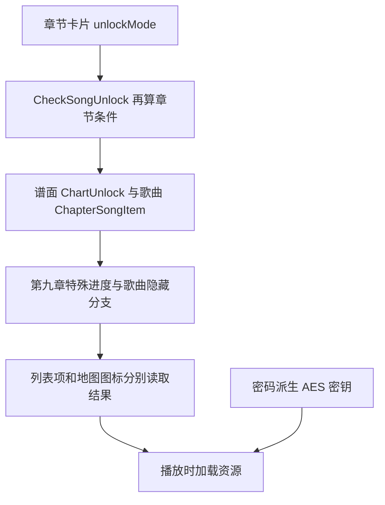
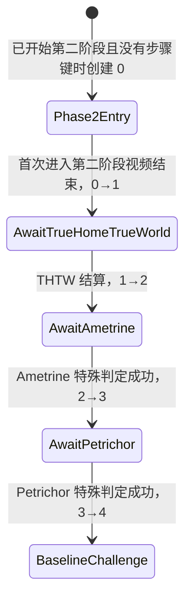

# Phigros 4.0.1.1 第九章原始逻辑与当前实现

[项目首页](../README.md) · [Agent 接手速查](../docs/handoff.md)

以下原版逻辑由原始 ARM64 指令、IL2CPP 元数据及 Unity 配置静态核实。RVA 只适用于当前 4.0.1.1 样本。Mod 的全曲解锁效果由用户确认；原版事件与密码算法按静态证据记录。

第九章地图 `Chapter9SongUnlockSprite.Awake` 在 `0x1D0E8AC` 直接调用 `CheckSongUnlock`，在 `0x1D0E8B8` 检查返回类型。章节卡片和核心判定分别读取 `unlockMode`；THTW 另有 `CurrentStep <= 0` 的隐藏分支。这些读取点由核心补丁和命名进度共同处理。

## 1. 解锁分为五层



章节配置：`MainStory9.unlockMode=1`，前置曲为 `DistortedFate.Sakuzyo.0`，普通路径要求任一难度达到 880000。

12 首歌曲的 `ChapterSongItem.unlockType` **全部是 2**，`unlockInfo` 各自只含一个命名存档键；`secretType` 都是 0。因此这组歌曲配置的歌曲锁读取对应命名键。

## 2. 全部歌曲与实际键

| 歌曲 | PlayerPrefs 键 | 有 AT |
|---|---|---|
| About The Universe | `C9AboutTheUniverseUnlocked` | 否 |
| Implexrough | `C9ImplexroughUnlocked` | 否 |
| Evanescent | `C9EvanescentUnlocked` | 否 |
| Entrance to the Chaos | `C9EntranceToTheChaosUnlocked` | 是 |
| Exoplanetary Mirage | `C9ExoplanetaryMirageUnlocked` | 是 |
| True Home, True World (Rework) | `C9S6Unlocked` | 否 |
| Ametrine | `C9AmetrineUnlocked` | 是 |
| Petrichor | `C9PetrichorUnlocked` | 是 |
| ハテ | `C9HateUnlocked` | 是 |
| Desultory Signals | `C9DesultorySignalsUnlocked` | 是 |
| Message | `C9MessageUnlocked` | 是 |
| What do you want more than a Happy ending? | `C9HappyEndingUnlocked` | 是 |

谱面存在性来自 `SongsItem.difficulty[i]`；0 表示不存在。前述四首没有 AT，不能将它们的“三个难度”误认成未解锁。

普通难度解锁仍走 `ChartUnlock` 的成绩/钥匙条件。**Desultory Signals 的 AT 额外配置为 `unlockType=2, unlockInfo=["Chapter9Phase2Passed"]`**。`CheckSongUnlock` 还对 MainStory9 中已有 AT 的歌曲执行章节通关后的 AT 放行逻辑。

原始配置见 `chapter9-song-config.json`，由 `level0` 的 `GameInformation` 实例解析。

## 3. 第一阶段：收藏品、歌曲结算与隐藏挑战

| 步骤 | 已确认的代码条件/效果 | RVA |
|---|---|---|
| 初入地图 | 进入 `Chapter9SelectMusic` 可取得 `nizhidaoma`、`m9beginning` 首条；阅读后继续解出收藏品链 | 配置 `level0/GetCollectionControl` |
| About The Universe | 已读 `nizhidaoma1`；当前结算歌曲为 HumaN；尚未解锁；本次 `IntScore >= 880000`，写对应键 | `0x1D7ED34` |
| Implexrough | 已读 `poyidomegino0`；当前结算歌曲为 Implexrough；尚未解锁，写对应键。这个结算处理器本身没有分数阈值 | `0x1D7F4D0` |
| Evanescent | 已读 `poyidomejiu0`、尚未解锁、完成歌曲为 Evanescent，写对应键；这里也没有分数阈值 | `0x1D7F0D0` / `0x1D8AE48` |
| Exoplanetary Mirage 流程可用 | `Chapter9UnlockBegin && !C9ExoplanetaryMirageUnlocked && IsCollectionRead("poyidomejiu1")` | `0x1D0CD98` |
| 隐藏第三曲选择 | 选择列表正好两首，顺序 **Evanescent → About The Universe**，两项难度索引相同；第三首补 Exoplanetary Mirage | `0x1D0D090` / `0x1D0D02C` |
| 两首隐藏挑战曲持久解锁 | 成功结算分支调用 `UnlockC9HiddenSongKeys`；读取挑战列表第三项及 `hiddenChallengeSongItem`，用歌曲→键表解锁 Exoplanetary Mirage / Entrance to the Chaos | `0x1D24064` / `0x1D24350` / `0x1D246E4` |
| 密码关 | 真实密码解开隐藏资源；密码成功后启动 C9S6，完成事件写 `C9S6Unlocked` | `0x1D4B0A8` / `0x1CF15D0` |

上表区分“使事件可进入”和“结算后保存解锁”。例如 Implexrough 的结算函数不检查分数，不代表正常菜单会在没有前置条件时直接提供该曲。本报告没有把完成处理器等同于完整的玩法入口。

关键收藏品配置：

- `nizhidaoma` 第 2 条：阅读 `nizhidaoma` 第 1 条后取得。
- `qiongdingguzhou` 第 1 条：阅读 `m9beginning` 后取得。
- `poyidomejiu`、`poyidomegino` 第 1 条：阅读 `qiongdingguzhou` 后取得。
- `poyidomegino` 第 2 条：`C9ImplexroughUnlocked && C9EvanescentUnlocked`。
- `poyidomejiu` 第 2 条、`sundemimi` 首条：`C9EntranceToTheChaosUnlocked`。
- `liangrenhuihe`：Exoplanetary Mirage 与 Entrance to the Chaos 都解锁。
- `blackhole`：`C9S6Unlocked`。

场景里的 `collectionSubIndex` 是 **0 起算**；数据库的 `CollectionItem.subIndex` 是 **1 起算**。`IsCollectionRead("poyidomejiu1")` 指第 2 条已读，不是“第 1 条”。

存档形式是计数：

```text
1keypoyidomejiu = 2                    # 前两条已获得
poyidomejiuCollectionTextOpened = 2     # 前两条已读
```

仅持有收藏品与已经阅读收藏品是两个条件。对应方法：`UnlockCollectionTo=0x1CA8F68`、`MarkCollectionRead=0x1CA96E4`、`IsCollectionRead=0x1D0CE6C`。

## 4. 密码确实用于解密资源

`C9SecretAssetBundleProvider.SetPassword=0x1D2951C`：

```python
h = SHA512(password.encode("utf-8"))
aes_key = h[0:32]
aes_iv  = h[32:48]
# Aes.Create() 默认 CBC、PKCS7
decrypted_bundle = AES_CBC_PKCS7_DECRYPT(bundle, aes_key, aes_iv)
```

然后异步加载地址 `c9s.test`，要求得到 `TextAsset` 且内容等于 `pass`。加载未完成时 `PasswordIsCorrect` 为 nullable 的空值，失败后为 false，成功为 true。

`Chapter9InputPasswordControl.Submit` 等待该结果；成功才保存输入为 `Chapter9SecretPassword`，播放正确提示音，再启动 C9S6。`GameProgressSaveModule.Apply` 恢复密码时也会调用资源 provider 的 `SetPassword`。

因此：`C9S6Unlocked=True` 是歌曲进度，不等于已经配置资源解密密钥。强制 `PasswordIsCorrect=true` 无法解密实际内容。当前 Mod 不处理这些资源的解密。

## 5. 第二阶段状态机

`Chapter9Phase2Progress.LoadCurrentStep=0x1D1E654` 只读取 **`Chapter9Phase2Step`**，并用枚举校验。合法值为 0–4；越界退回 0。它不会因为 `Chapter9Phase2Passed=true` 自动推导成步骤 4。



| 步骤值 | 名称 | 进入下一步的实际处理 |
|---|---|---|
| 0 | Phase2Entry | `TryAwaitTrueHomeTrueWorld()` 执行 `TryAdvance(0,1)` |
| 1 | AwaitTrueHomeTrueWorld | THTW 的结算处理器写 `C9AmetrineUnlocked=True`，调用 `TryAwaitAmetrine()` |
| 2 | AwaitAmetrine | Ametrine 本次结果 `IsAmetrineChallengeFailed == false`，写 `C9PetrichorUnlocked=True`，调用 `TryCompleteAmetrine(false)` |
| 3 | AwaitPetrichor | Petrichor 本次结果 `IsPetrichorChallengePassed == true`，调用 `TryCompletePetrichor()` |
| 4 | BaselineChallenge | 基线挑战/拼图入口状态，**还不是最终通关状态** |

`TryAdvance` 要求当前步骤等于 expected，且只能逐步前进；`SaveStep(4)` 同时写 `C9BaselineChallengeReached=True`，步骤 3/4 的保存还会重新评估收藏品解锁。

结算门槛：

- THTW 结算处理器 `0x1D82D9C` 本身没有 A/S 分数阈值，条件是歌曲匹配且步骤为 1。
- Ametrine 的 `HandleBadOrMiss=0x1D45A08` 只在配置的 `[eventStartTime,eventEndTime]` 窗口内将 `judgeCheckFailed` 置真，并调用 `ScoreControl.BlockCombo`。结算时将它复制到 `LevelResultInfo+0x40`；不是简单检查历史最高分或整首 FC。
- Petrichor 的 `HandleMiss=0x1D4A088` 只在 `isTouchingBlock` 为真时标记失败并冻结分数；`SubmitResult=0x1D4A0C0` 计算 **本次分数≥880000 且未触发该失败**，写入结果 `+0x41`。
- Ametrine/Petrichor 事件看本次运行的结果字段；仅补历史成绩无法替代事件执行。

完整反汇编：`chapter9-progress.asm`、`chapter9-events.asm`、`chapter9-judgement.asm`。

## 6. 拼图与最终完成

`Chapter9Phase2Control.OpenSongDetail=0x1D1A3E4` 中：

```csharp
if (songId == "ハテ.rNFrums.0" && CurrentStep == 4 && !Chapter9Phase2Passed)
    EnterAwaitKeyCollections(); // 实际继续进入拼图协程
else
    OpenNormalOrLockedSongDetail();
```

`EnterAwaitKeyCollections`（`0x1D19AEC`）直接启动 `EnterPuzzle`；本节描述这一已核实的调用路径。

`level35` 配置了 **6 块拼图**。每块 `Completed` 仅是 `state == Completing(3)`，不是持久存档位。拖拽放下、吸附、完成通知由拼图对象自己的状态机驱动；`OnPieceCompleted` 汇总各块状态，全部成立后播放完成动画与确认弹窗。只改 `get_Completed` 不能保证触发完成事件。

确认下一阶段后，`PlayNextStage.MoveNext=0x1D3F2F8` 重置 session，调用 `TryBeginBaselineChallenge(config, level)`、`TryApplyCurrentLevel`，进入实际关卡。

挑战配置（已从 `sharedassets35.assets` 中实际读出）：

1. ハテ + `LevelMod/HateLevelEffects`
2. Desultory Signals + `LevelMod/DesultorySignalsLevelEffects`
3. Message + `LevelMod/MessageLevelEffects`

运行态 `Stage` 与持久化 `Step` 是两套值：`HatePlaying(1) → DesultoryUnlockVideo(2) → DesultoryPlaying(3) → MessagePlaying(4) → MessageStory(5) → HappyEndingVideo(6) → Credits(7)`。`TryCompleteCurrentSong` 校验 session 活跃、关卡已准备、曲目索引与 Stage 匹配，再推进；单独修改持久步骤并不会生成这些运行时对象。

最终持久完成写入者是 **`C9AfterDeductionControl.<Start>.MoveNext=0x1D4295C`**。协程首次执行时：

```text
Chapter9Phase2Passed = True
C9HateUnlocked = True
C9DesultorySignalsUnlocked = True
C9MessageUnlocked = True
C9HappyEndingUnlocked = True
删除 C9PendingMessageAfterQuit / C9PendingMessageLevel
GameCompleted = "4.0"
重新评估收藏品，PlayerPrefs.Save()
```

`CompleteChapterFromAboutUs` 这个方法名容易误导：在当前二进制里它只检查 `Step==4 && Session.IsActive && Stage==Credits`，条件不满足则记错误，**自身没有写任何完成标志**。不能将方法名当成通关 API。

## 7. 当前 Mod 实现与证据

完整构建应用六处解锁补丁，初始化真实 `C9*Unlocked`、`Chapter9Phase2Step=4`、`Chapter9Phase2Passed=True` 等键，并清除两个 PendingMessage 键。实现见 `modules/unlock/chapter9_save.py` 和 `tools/build_unlock_apk.py`，补丁表见 [全曲解锁实现](phigros-unlock-analysis.md)。

全文本收藏品由 `all_collection_progress()` 按完整目录生成，已阅读键为 `<key>CollectionTextOpened`；曲绘和头像由 `all_cosmetic_progress()` 按 keyStore 生成。目录及验证见 [收藏品说明](collections-unlock.md)。

存档 CLI 无输出路径时只审计，指定独立输出文件才生成新 XML；`--format encrypted` 使用游戏加密格式，逐条保留成绩 XML。完整 APK 构建通过 Bootstrap 自动写入目标进度。

静态证据：`chapter9-assets.json`、`chapter9-song-config.json`、`chapter9-progress.asm`、`chapter9-gates.asm`、`chapter9-phase1-complete.asm`、`chapter9-password-ending.asm`、`chapter9-challenge-ending.asm`、`chapter9-events.asm`。配置覆盖 GameInformation、收藏品、两张地图、六块拼图和挑战配置；读取长度校验通过。
