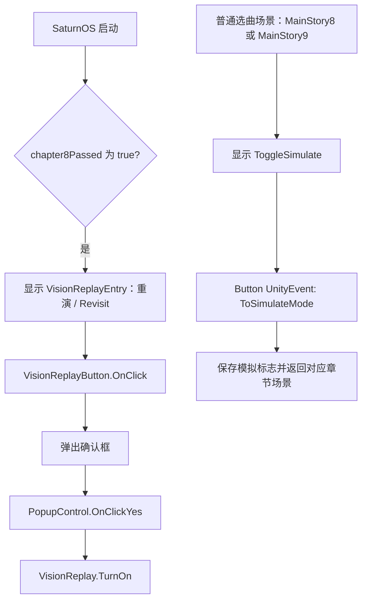

# Phigros 4.0.1.1 调试选项与重演逻辑还原

分析日期：2026-10-21。样本为本目录原版 `Phigros_4.0.1.1.apk`，Unity 2022.3.62f2、IL2CPP、ARM64。以下是静态分析结论；没有通过修改 APK、写入存档或操作设备来验证开启效果。

**确实保留了被禁用的重演状态检查组件，以及完整的重演／模拟模式逻辑。未发现可直接认定为通用 GM 菜单、自动打歌或全解锁总开关的入口。** 重演有正式按钮、多语言文案和进度条件，应当与开发调试功能区分。

## 已核实的候选项

| 候选项 | 证据 | 判断 |
| --- | --- | --- |
| `Vision Replay Inspector` | 两个场景保留对象和脚本；`Inspector.Start` 显示重演／模拟状态；两个脚本均 `m_Enabled=0` | 明确的禁用状态检查组件，最值得学习和恢复观察 |
| `VisionReplay` / `IsSimulateMode` | 保存开关、临时重演进度、场景切换和有效按钮回调都存在 | 游戏重演系统，不能仅因名字认定为开发者作弊模式 |
| Rendering Debugger | 保留 Ctrl、Backspace 等输入配置；三个初始化／输入注册函数仅有 `ret` | Unity 渲染库残留，不能据此声称组合键能打开菜单 |
| `SamplePopupView.DebugLog` | 写入 UI Text，并调用 `UnityEngine.Debug.Log`；其余方法演示原生对话框和日期选择器 | 示例组件；38 个构建场景未找到挂载 |
| `ImportCollections` | `[ExecuteInEditMode]`、文本导入字段与 `Update` 实现 | 内容制作工具残留；38 个构建场景未找到挂载 |
| `NaughtyAttributes.Test.dll`、TrueShadow Demo 等 | 程序集和测试／示例类仍在元数据中 | 第三方测试和示例代码，不能当作游戏自身的隐藏菜单 |
| `SongDetailAutoPlayPresenter` | 展示曲目信息、等待动画、加载 `Level` 场景 | 此处 AutoPlay 指自动推进展示流程；没有据此发现自动判定功能 |

## 1. 最明确的检查组件：Vision Replay Inspector

源码定位：`ildump/dump.cs`，`Phigros2.VisionReplay.Inspector`，TypeDefIndex 4178。

`Start` RVA：`0x1CE0A70`。下面是按原生指令还原的等价伪代码，不是开发者原始源码：

```csharp
public void Start()
{
    text.enabled = VisionReplay.IsOn;
    text.text = "Vision Replay: ON\nSimulate Mode: "
        + (VisionReplay.IsSimulateMode ? "ON" : "OFF");
}
```

它只在 `Start` 更新文字，没有发现 `Update` 实时刷新方法。

原版场景中的状态：

| 场景 | GameObject PathID | Inspector PathID | Inspector 启用 | Text PathID / 启用 | 对象 activeSelf |
| --- | --- | --- | --- | --- | --- |
| `level6` / ChapterSelector | 29 | 3715 | 0 | 3716 / 0 | true |
| `level7` / SongSelector | 193 | 878 | 0 | 877 / 1 | false |

这比只搜到一条 `Debug` 字符串更有力：代码、文字、UI 对象和字段绑定同时存在。若之后做本地观察版，需要考虑脚本启用、对象及父对象激活、`VisionReplay.IsOn` 条件，单改 Text 的可见性不足以让 `Start` 执行。这里的 activeSelf 不代表完整父链在运行时可见。

## 2. 重演与模拟模式的实际关系

关键地址均为当前原版 ARM64 库 RVA：

| 方法 | RVA |
| --- | --- |
| `VisionReplay.TurnOn` | `0x1CE0CCC` |
| `VisionReplay.TurnOff` | `0x1CE0F10` |
| `VisionReplay.BootSimulateMode` | `0x1CE0FDC` |
| `VisionReplay.ExitSimulateMode` | `0x1CE1020` |
| `VisionReplay.InitC8ReplayProcess` | `0x1CE0DC8` |
| `VisionReplay.ResetC8Process` | `0x1CE1060` |
| `VisionReplay.RecoverC8SecondPhase` | `0x1CE1410` |
| `SongSelector.ToSimulateMode` | `0x1DA40A0` |

按指令省略 IL2CPP 类型初始化代码后：

```csharp
static void TurnOn()
{
    SaveManagement.SaveBool("IsVisionReplayOn", true);
    IsOn = true;
    IsSimulateMode = SaveManagement.LoadBool("IsSimulateMode", false);
    InitC8ReplayProcess();
}

static void TurnOff()
{
    SaveManagement.SaveBool("IsVisionReplayOn", false);
    IsOn = false;
    IsSimulateMode = false;
}

static void BootSimulateMode() => IsSimulateMode = true;
static void ExitSimulateMode() => IsSimulateMode = false;
```

注意：`BootSimulateMode` 和 `ExitSimulateMode` 自身只改静态布尔字段。`TurnOff` 没有同时把存档里的 `IsSimulateMode` 写成 false，不能把内存状态和持久值混为一谈。

`InitC8ReplayProcess` 检查的是重演专用键：

```csharp
if (SaveManagement.LoadBool("VRChapter8Passed", false))
    ResetC8Process();
if (SaveManagement.LoadBool("VRFirstOpenGameAfterChapter8FirstPhaseClear", false))
    RecoverC8SecondPhase();
```

`VisionReplay.Key` 的静态构造器 `0x1CE21D4` 给键名赋值，例如：

- `VRUnlockFlagOfSpasmodic`、`VR重生KeyCompleted`、`VRUnlockFlagOfIgallta`、`VRUnlockFlagOfRrharil`。
- `VRChapter8UnlockBegin`、`VRChapter8UnlockSecondPhase`、`VRChapter8Passed`。
- `VRC8CraveWaveUnlocked`、`VRC8TheChariotREVIIVALUnlocked` 等六首第八章歌曲状态。

`VisionReplay.Process`、`VisionReplay.C8Unlock` 还保留内存字典的 GetValue／SetValue／Reset。这些命名和调用共同支持“重新体验剧情／解锁流程”的解释，而不是玩家操作录像回放或自动打歌。

### 按钮和入口



`SaturnOSControl.<Start>d__34.MoveNext` 在 `0x1D95654–0x1D9568C` 读取普通 `chapter8Passed`，成立后显示 `visionReplaySummary` 所绑定的 `VisionReplayEntry`（GameObject PathID 98）。该对象在场景文件中初始 inactive，**这是由进度动态显示的正式入口，不能只看初始 inactive 就称它被彻底关闭。** 按钮文案的中文为“重演”、英文为“Revisit”。

选曲场景 `level7` 的 `ToggleSimulate`（GameObject 6、Button 645）初始 inactive，但 `SongSelector.Start` 在当前章节为 `MainStory8` 或 `MainStory9` 时会调用 `SetActive(true)`，对应 `0x1DA4F8C–0x1DA4FE0`。

Button 的序列化 UnityEvent 仍绑定 `SongSelector`（691）的 `ToSimulateMode`，CallState 为 2（运行时执行）。所以即使汇编里没有直接 `bl ToSimulateMode`，该方法仍有有效 UI 调用路径。

该方法的等价行为：

```text
当前章节 MainStory8：
  exit = true
  SaveBool("IsSimulateMode", true)
  VisionReplay.BootSimulateMode()
  开始切换到 Chapter8SelectMusic，播放切出效果／音效

当前章节 MainStory9：
  exit = true
  SaveBool("IsSimulateModeC9", true)
  开始切换到 Chapter9SelectMusic，播放切出效果／音效
```

第九章分支没有调用 `BootSimulateMode`，不能把 C8、C9 的模拟标志当成同一个开关。`Chapter8SelectMusicControl.ToSongList` 另有调用 `ExitSimulateMode` 的路径。

启动协程末尾还有一次性恢复路径：读取 `VRFirstOpenGameAfterChapter8FirstPhaseClear`，成立时执行 `TurnOn()`、`BootSimulateMode()`，随后删除该键，地址 `0x1CD0D1C–0x1CD0E18`。这是启动恢复机制，不能仅凭 `IsVisionReplayOn` 的名字推断完整启动条件。

这些字符串是 SaveManagement 的**逻辑键**。已核实 `SaveBool` / `LoadBool` 对键和值使用加密后存入 PlayerPrefs；直接添加同名明文 XML 项不会等价启用此功能。

## 3. Unity Rendering Debugger：配置还在，初始化为空

原版 `globalgamemanagers` 的 InputManager 保留：

| 输入名 | 键盘 | 手柄替代 |
| --- | --- | --- |
| Enable Debug Button 1 | Left Ctrl | button 8 |
| Enable Debug Button 2 | Backspace | button 9 |
| Debug Reset | Left Alt | button 1 |
| Debug Next / Previous | Page Down / Page Up | button 5 / 4 |
| Debug Validate | Enter | button 0 |
| Debug Persistent | Right Shift | button 2 |
| Debug Multiplier | Left Shift | button 3 |
| Debug Horizontal / Vertical | 方向键 | 对应手柄轴 |

同时原生库中这三个方法仅剩一条 `ret`：

```text
0x3B563A8 DebugManager.EnableInputActions
0x3B56DB0 DebugManager.RegisterInputs
0x3B5DB48 DebugUpdater.RuntimeInit
```

DebugUI Canvas、Widget、Handler 等类型仍保留，但 38 个构建场景未发现对应挂载。因此目前只能确认渲染调试库和按键配置残留，**没有确认 Ctrl + Backspace 在原版运行时能打开菜单**。渲染检查器即便被手动实例化，也不等于歌曲、分数和解锁管理界面。

其他构建证据：Java `BuildConfig.DEBUG=false`、`BUILD_TYPE="release"`；原版 `boot.config` 的 `wait-for-native-debugger=0`。后者只表示启动时不等待原生调试器。

## 4. 其他容易误判的名称

`RemoveAllSongControl.Awake`（`0x1D5A028`）实际是读取 `GameCompleted` 和 `chapter8Passed`，条件不足时销毁它所挂载的 `AllSong` UI 对象，不是“删除所有歌曲或清空成绩”的调试命令。

`Ch8Effect.MessageController.WasContinuePressed` 和第九章几个 `WasAdvanceInputPressed` 接受鼠标／触摸、Return、KeypadEnter、Space。这些是剧情推进输入，不是隐藏控制台快捷键。对 ARM64 代码段的直接分支扫描，游戏代码中 `Input.GetKeyDown` 的匹配也集中在这些剧情方法；扫描不覆盖间接调用、反射或其他输入系统。

`SongDetailAutoPlayPresenter` 的协程 `0x1D3E268` 处理封面背景、展示时长、动画和 `SceneManager.LoadScene("Level")`。普通游玩仍沿 `JudgeControl → CheckNote / CheckFlick`、`NoteUpdateManager → 各音符 Judge`、`ScoreControl` 路径处理。没有从这些候选项确认自动 Perfect／AP 功能。

## 5. 用于学习的主逻辑导航

```text
BootSceneControl 启动协程
  → GameInformation：当前章节、开局参数、设置、歌曲数据库
  → ChapterSelector / SongSelector / 第八九章专用场景
  → CheckSongUnlock：章节门槛、歌曲锁、难度存在性、钥匙和显示条件
  → LevelStartInfo：曲目、难度、谱面和音频资源地址、levelMods
  → LevelControl：读谱、生成判定线和音符、设置资源
  → ProgressControl：音乐时钟、暂停恢复、结束与场景转移
  → JudgeControl + NoteUpdateManager：输入、音符状态、判定
  → ScoreControl / LevelResultInfo：分数、连击、结果
  → SaveManagement：本地加密存档
```

已有的细节资料可继续对照：[核心解锁分析](phigros-unlock-analysis.md)、[第九章逻辑](chapter9-logic.md)、[练习模式实现](practice-mode-implementation.md)。本报告不把 IL2CPP 的声明 dump 当成完整源码：`dump.cs` 中空方法体只提供字段、签名和地址，以上行为依据对应原生指令与资源绑定还原。

## 复现与证据

- [场景扫描工具](../tools/inspect_debug_options.py)：读取原 APK 全部 38 个构建场景、InputManager 和脚本绑定；本次 13 个候选组件、1 个相关序列化回调，0 个解码错误。
- [场景与字段 JSON](debug-options-scenes.json)：含组件启用状态、引用对象及输入配置。
- [核心反汇编](debug-options-core.asm)：Inspector、VisionReplay、模拟按钮、渲染初始化等。
- [启动和存档反汇编](debug-options-entry.asm)：启动恢复、重演键名构造、SaveBool／LoadBool。
- [菜单条件反汇编](debug-options-menu.asm)：章节列表和 SaturnOS 的运行时显示逻辑。
- [游玩调用记录](debug-options-gameplay-calls.asm)：自动展示协程与普通判定调用。
- [直接分支交叉引用](debug-options-xrefs.json)：按 ARM64 `b` / `bl` 扫描，方法归属按最近前置 RVA 标注；不包含 UnityEvent 等间接调用。

```bash
.venv/bin/python tools/inspect_debug_options.py
.venv/bin/python tools/chapter9_trace.py 'VisionReplay.*Inspector|VisionReplay\$\$|SongSelector\$\$ToSimulateMode'
```

已逐字节确认分析用 `work/lib/arm64-v8a/libil2cpp.so` 与原 APK 内同路径库一致，其 SHA-256 为 `43a198025f5fd19284339d6660b6d86a164da3967770e8e72abd2182168052b6`。

覆盖范围是该版本 ARM64 方法表、选定方法的原生指令、38 个 BuildSettings 场景和输入配置；没有穷举全部 Addressables 预制体和所有原生函数，也未执行运行时开关验证。因此“未发现通用控制台”是当前证据范围内的结论。
