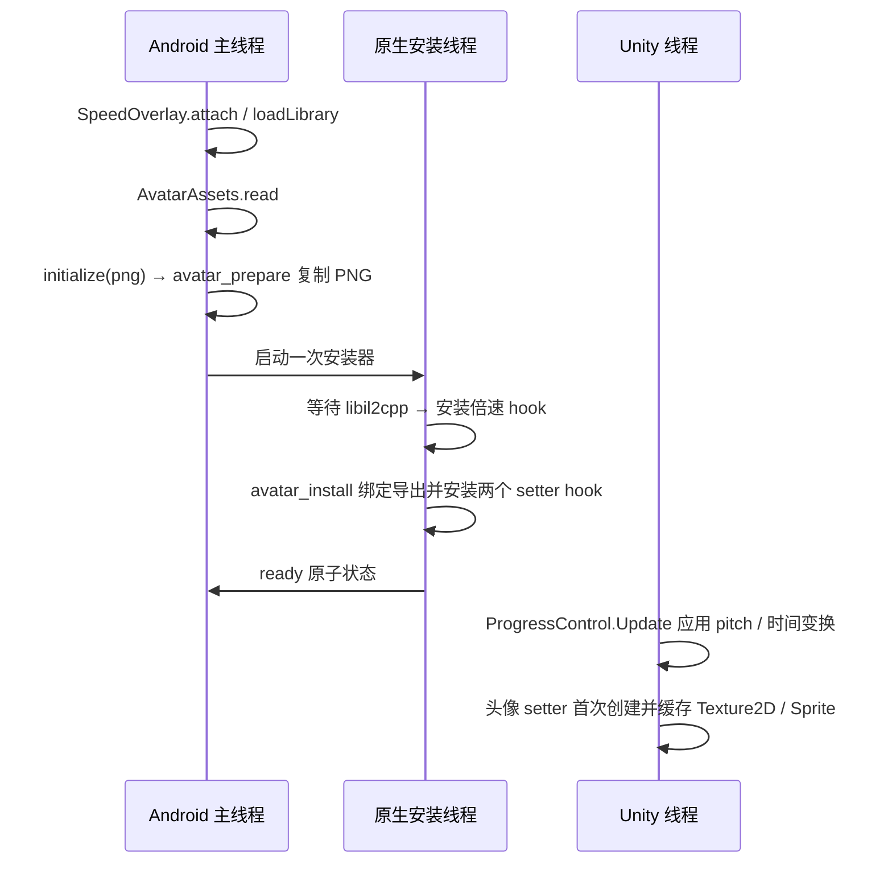

# Agent 接手速查

适用样本：**Phigros 4.0.1.1 / Unity 2022.3.62f2 / IL2CPP / ARM64**。先读 [AGENTS.md](../AGENTS.md)，再按 [功能索引](../modules/README.md) 进入模块。只有需要原始依据时才查 [研究索引](../analysis/README.md)，不必扫描全部反汇编。

环境缺工具时先读 [下载与安装](setup.md)；Windows 另读 [Windows / WSL2 工具链](setup-windows.md)。本文命令使用 Linux / WSL2 Bash，原生 PowerShell 的命令及现有构建缺口在 Windows 指南中单列。

## 版本工作流入口

当前生产代码、构建和回放已读取 [版本档案](../profiles/README.md)。新版本从 [port workflow](workflows/port-version.md) 开始。`tools/versions.py prepare/locate/scan-assets` 保存草稿和候选；原字节、ABI、资源和回放核对后再构建。当前版本也可统一运行 `tools/versions.py verify --generate`、`tools/versions.py replay`、`tools/build_all.py`。

新产物在 `dist/versions/4.0.1.1-arm64-d373432ce775/`，每阶段有 APK 来源记录。原 dist 根目录中的成品保留作历史对照。新中间库在本样本 `work/versions/.../speed/libspeed.so`；NDK/签名仍在原持久位置。当前来源指纹覆盖整个 modules/tools 源树，源码更改后用总构建刷新上游。

## 当前状态

| 项目 | 当前约定 |
| --- | --- |
| 全收藏品基线 | `dist/versions/4.0.1.1-arm64-d373432ce775/Phigros_4.0.1.1_Unlock_arm64_Practice_mod_AllCollections.apk` |
| 最新整合包 | 同目录 `_Practice_mod_AllCollections_Speed.apk`，共八个功能模块 |
| 包名/签名 | `com.PigeonGames.Phigros.unlock`；沿用 `work/apk-build/local-unlock.jks`，备份在 `backups/signing-2026-10-20/` |
| 已有用户确认 | 全曲、水印、练习 v2、全收藏品、倍速；证据范围见各模块 |
| 判定修复 | Update 每帧生成窗口后补偿，五处 Drag/Flick/Hold 独立门槛已补偿；真实指令回放通过，实际手感待用户验收，见[判定实现](../analysis/speed-mod.md#判定窗口补偿) |
| 待设备确认 | 头像跨场景实际显示，以及判定修复后的实际游玩手感（本次 MuMu 覆盖安装和启动已确认） |
| 存档边界 | 保留游戏加密，不注入成绩；普通单曲练习沿用原成绩处理 |

原版 APK SHA-256：`d373432ce775d9c8b3f4af9f72ff79a14c39dd159735cfc202b75a78a1835a14`。换机器或下载输入后先运行 `sha256sum -c Phigros_4.0.1.1.apk.sha256`，摘要不符时先解决样本差异；版本号不能替代完整文件校验。摘要来源及具体约束见 [材料地图](local-materials.md#原包与同源材料不入-git)。

## speed/avatar 从哪里改

| 修改目标 | 入口 |
| --- | --- |
| 倍速 UI、显示范围、JNI 调用 | [SpeedOverlay.java](../modules/speed/SpeedOverlay.java) |
| pitch、判定窗口、生产 Update、安装线程、trampoline | [speedmod.c](../modules/speed/speedmod.c) |
| 五处独立判定门槛与跳板 | [speed_judgement.c](../modules/speed/speed_judgement.c)、[speed_judgement.h](../modules/speed/speed_judgement.h) |
| 时间变换公式 | [speed_clock.h](../modules/speed/speed_clock.h) |
| 头像 PNG 读取 | [AvatarAssets.java](../modules/avatar/AvatarAssets.java) |
| 头像模块与安装器之间的接口 | [avatar.h](../modules/avatar/avatar.h) |
| IL2CPP 导出地址、Sprite、GC handle、加载器回调 | [avatar_hook.c](../modules/avatar/avatar_hook.c) |
| 新增头像目录条目及解锁键 | [level0_avatar.py](../modules/avatar/level0_avatar.py) |
| 头像源图 | [zundamon.png](../modules/avatar/assets/zundamon.png)，当前约定 128×128 RGBA |
| APK、Java/native 编译、Activity 接入及 Bootstrap | [build_speed_apk.py](../tools/build_speed_apk.py) |
| 共享加密存档写入指令 | [build_unlock_apk.py](../tools/build_unlock_apk.py) 的 `bootstrap_entries` / `bootstrap_smali` |

两个模块共同进入 `libspeed.so` 和 `classes3.dex`，练习模块仍在 `libpractice.so` / `classes2.dex`。共用打包步骤不等于共用可写全局变量：PNG、IL2CPP 绑定和头像缓存由头像模块持有。

## 运行顺序与线程



`initialize` 先复制 PNG，后启动线程；重复 Activity 接入不重复安装 hook。安装线程只定位库、绑定函数指针和改写入口，不创建 Unity 对象。头像 setter 和倍速 Update 由游戏在 Unity 线程调用。Java 的 `speed(value)` 同步写原子请求，下一次 Update 应用；UI 无需额外等待计时器。

头像资源由两个强 GC handle 与 `DontUnloadUnusedAsset` 保留，生命周期覆盖整个进程；切场景时加载器只借用资源。赋值前复用原版 `OnDisable` 取消旧加载/释放引用，完成后设置加载标记并调用 `onLoaded`。仅拦截 `avatar.Zundamon`，其他键走原函数。每次启动的 Bootstrap 会重新选中 Zundamon。

## 最短验证与构建路径

从仓库根目录执行：

```bash
.venv/bin/python modules/avatar/test_avatar.py
.venv/bin/python modules/speed/test_speed.py
.venv/bin/python modules/speed/test_judgement.py
.venv/bin/python modules/practice/test_timing.py
.venv/bin/python tools/build_speed_apk.py
git diff --check
```

`test_avatar.py` 运行生产原生库，覆盖生命周期、旧加载清理、两个 setter 的 ABI、trampoline、回调/透传和单次初始化顺序，共六项。它也提供倍速生产 hook 回放使用的 ELF/Unity 模拟边界。

`test_speed.py` 包含生产 `ProgressControl.Update` 回放（变速连续性、Seek、换曲、pitch 写入、还原 raw 时钟；真实窗口写回由 `test_judgement.py` 单独执行），以及原版 ARM64 音频 Update 的 24 个模型场景。模型中的 Seek 会重置完整时钟状态，编译每种库只做一次。`test_judgement.py` 还执行五处真实加载/比较指令，验证普通/挑战模式、重复倍速、提前返回和 1x 恢复，不只检查模拟边界。头像回放不执行真实 Unity 渲染；时钟回放不测设备音频输出延迟。

只改 speed/avatar 时，用已存在的全收藏品基线执行最后一步即可。改上游才按 [完整依赖链](modding-guide.md#7-构建与缓存) 重建；`tools/build_all.py --list` 预览，`--target collections` 停在基线。不要删除整个 `work/`，里面含原始库、NDK 和签名工具。各机器输入见 [本地材料地图](local-materials.md)。

## 必须保留的约束

- 五处独立判定门槛在 `speed_judgement.c` 中，各覆盖一条 4 字节加载并跳转到私有常量跳板。MuMu 会忽略普通 mmap 提示，因此安装器使用 `MAP_FIXED_NOREPLACE` 申请附近空闲页，验证分支距离；保留此检查，不能用 MAP_FIXED 覆盖现有映射。
- 当前 hook 每次核对原字节；trampoline 仅支持已核实的入口，以及第四条 ADRP 的专用重定位。它不是通用 ARM64 hook 框架；换版本须重新定位，不能原样复制 PC 相对指令。
- 练习已经挂接 `Pause.Update` / `PlayScheduled`。倍速不重复挂接；`Seek` 入口的 ADRP 不在当前支持位置，继续通过时钟跳变重锚。
- `work/lib/arm64-v8a/libil2cpp.so` 保持原始样本；APK 中的库和运行时地址另记，RVA/文件偏移通过 ELF PT_LOAD 换算。
- 所有阶段每次从真实上游重新解码 DEX 壳。保留包内非目标条目、签名/对齐检查及模块源码的唯一入口。
- 更新源码时同步模块 README、对应研究说明和 [结果汇总](../总结.md)。构建日志、产物校验和设备反馈分开记录，不能用历史设备结果替代本次验证。
