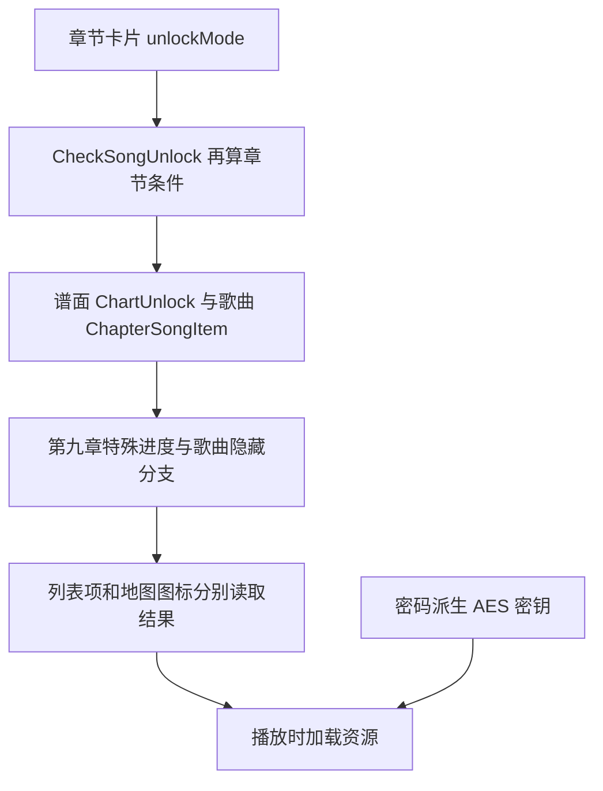
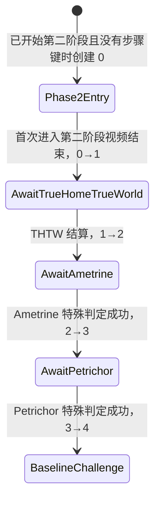

# Phigros 4.0.1.1 无成绩全解锁与水印版总结

日期：2026-10-20。工作区：`/home/missi/project/phigros-test`。
本文以最终安装包、构建脚本、IL2CPP 元数据、原始库反汇编、Unity 序列化数据及本次实测反馈为准；早期报告中的阶段性结论以本文更正为准。

## 最终结果与交付物

用户已先后确认「全曲都解锁了」和水印「确实成功了」，本次全曲解锁目标完成。

- 不依赖刷分或伪造谱面成绩，放开章节、歌曲、实际存在的难度以及显示条件。
- 第八、九章初始化相应进度；第九章地图、歌曲和难度锁问题已解决。
- 应用名：**Phigros 解锁版**；包名：`com.PigeonGames.Phigros.unlock`，与原版共存、使用独立存档。
- 水印：**ずんだもん**，右下角半透明，非游玩场景显示，实际游玩谱面时不显示。
- 已重新签名、通过 v2/v3 与 ZIP 对齐检查、覆盖安装，用户确认效果成功。
- 全曲解锁与隐藏剧情资源的密码解密是独立机制：本次未求解真实密码，也未解密 `c9s.*` 剧情资源。

当前整理后的唯一成品为 [dist/Phigros_4.0.1.1_Unlock_arm64.apk](dist/Phigros_4.0.1.1_Unlock_arm64.apk)。该文件是成功的水印版；构建时曾名为 `_watermarked.apk`，当前文件名已整理。不要与 `work/apk-build/` 内同名前缀的旧失败包混淆。

签名备份目录：[backups/signing-2026-10-20](backups/signing-2026-10-20/README.md)。可单独保存的压缩包：[phigros-signing-2026-10-20.tar.gz](backups/phigros-signing-2026-10-20.tar.gz)。

## 样本、引擎与分析方法

原 APK：`Phigros_4.0.1.1.apk`，2469212554 字节；Unity **2022.3.62f2**，IL2CPP，metadata v31。
原 APK 有 ARM 原生库，最终包只保留 `arm64-v8a`，去除 `armeabi-v7a`。
Java 主要是 Unity Player 和 SDK 壳；目标解锁逻辑在 `libil2cpp.so`，场景/配置在 `assets/bin/Data/level*`、sharedassets，音乐等资源还使用 Addressables。

- Il2CppDumper 输出 `ildump/dump.cs`、`script.json`、DummyDll；方法表有 164420 条记录，可为反汇编标注调用目标。
- Capstone 结合 ELF 段映射恢复条件分支与跳转表；必须按 PT_LOAD 做地址换算。
- UnityPy + TypeTreeGenerator 从 DummyDll 恢复 MonoBehaviour 字段树，读取章节、歌曲、收藏品、地图、拼图与挑战配置。
- 生成字段树时补充 bool/UInt8 对齐标志，并修正部分列表的 vector 标记，避免错误读取后续字段。
- 运行时使用 adb/logcat/截图确认启动；最终解锁和水印效果由用户手动验证。

ELF PT_LOAD 映射：

```text
file offset 0x0000000 -> VA 0x0000000，size 0x19435b4，R
file offset 0x19435b4 -> VA 0x19475b4，size 0x25546dc，RX
file offset 0x3e97c90 -> VA 0x3e9fc90，size 0x347378，RW
file offset 0x41df008 -> VA 0x41eb008，size 0x28a4d8，RW
```

代码段可用 VA-0x4000，但该规则不适用于只读常量段。早期把此偏移套到跳转表，曾误读成字符串；后续已按各段修正。字面量槽还需处理 `R_AARCH64_RELATIVE` 重定位，不能把文件里的零值当作运行时空引用。

## 核心解锁逻辑与最终六处补丁

`GameInformation.CheckSongUnlock`（RVA `0x1CBCC74`）合并章节门槛、谱面条件、歌曲锁、出现条件及第九章特例。章节卡片和列表/地图还分别读取这些结果。

| 数据 | 枚举语义 |
|---|---|
| `ChapterSelectorUnlockInfo.unlockMode` | 0 常开；1 指定歌曲 880000；2 Legacy 通关数量；3 指定歌曲 920000；4 钥匙 + 880000 |
| `ChapterSongItem.unlockType` | -1 常开；0 普通；1 游戏内货币；2 钥匙 AND；3 钥匙 OR；4 各谱面独立钥匙 |
| `ChartUnlock.unlockType` | -1 常开；0 普通成绩解锁；1 钥匙 ANY；2 钥匙 ALL |
| `ChapterSongItem.secretType` | 0 常显示；1 随解锁显示；2 钥匙 AND；3 钥匙 OR |

普通谱面解锁涉及前置谱面成绩或本谱面已留成绩；难度不存在时仍跳过。因此保持 `difficulty[i] == 0` 的存在性判断，不生成本来没有的 AT。
`SongSelectorItem` 按解锁数组自然计算可玩难度数量，不需要强改数量 getter。

最终 APK 从原始库开始，仅应用以下六处 4 字节等长修改，保留原存档加密：

| RVA | 原字节 | 新字节 | 新指令与效果 |
|---|---|---|---|
| `0x1CBD430` | `4a1140b9` | `0a008012` | `mov w10, #-1`，已有谱面常解锁 |
| `0x1CBD8EC` | `681b40b9` | `08008012` | `mov w8, #-1`，核心歌曲锁常开，覆盖地图/游戏内货币/钥匙路径 |
| `0x1DB0EA4` | `ff060031` | `ff02176b` | `cmp w23, w23`，列表构造器的 Unlocked 恒真 |
| `0x1CBCF78` | `091140b9` | `09008052` | `mov w9, #0`，核心歌曲判定的章节门槛常开 |
| `0x1D57D2C` | `081140b9` | `08008052` | `mov w8, #0`，章节卡片按常开路径显示并保留 PLAY 行为 |
| `0x1CBDC20` | `682b40b9` | `08008052` | `mov w8, #0`，常规 secretType 显示分支 |

前五处定义在 `tools/patch_min.py` 的 chart/song/chapter 组，第六处由 `tools/build_unlock_apk.py` 补入。构建检查原字节、汇编编码和反汇编结果；这些 RVA 仅对当前样本成立。
第九章尾部另有 THTW 的 Step<=0 隐藏分支，不能仅靠第六处替换覆盖，所以还要初始化真实进度。

## 存档格式与启动初始化

正式使用原游戏存档格式；最终 APK 没有应用旧脚本的 crypto 恒等化补丁，也没有调用写成绩的 Frida 路线。

原版：`/data/data/com.PigeonGames.Phigros/shared_prefs/com.PigeonGames.Phigros.v2.playerprefs.xml`。
共存版：`/data/data/com.PigeonGames.Phigros.unlock/shared_prefs/com.PigeonGames.Phigros.unlock.v2.playerprefs.xml`。
Bootstrap 以 `getPackageName() + ".v2.playerprefs"` 动态取得文件名，在 `Activity.onCreate` 后、Unity 初始化前提交数据，避免 Unity 启动后读取到旧状态。

逻辑键和值分别按下列方式存储：

```text
UTF-8 明文 -> AES-CBC/PKCS7 -> Base64 -> URL 编码 -> SharedPreferences string
```

存档 AES 派生：对 ASCII 种子每一字节，取下一字节（循环）与当前字节的 bit reverse 异或。

```python
key_seed = 'Phigros.enc.j57vnvr8wlZssXM7eWpa'
iv_seed  = 'Q4zHm5vUEMJJ3iS9'
out[i] = seed[(i+1) % len(seed)] ^ bit_reverse_8(seed[i])
```

```text
AES key = 627ff1942185e011c815e81e639b9a00001c766b826c29bd96578589f19a6fd6
AES IV  = be56167f83da3befeff81861a5c5f3cd
```

逻辑存档模块：user/settings/gameRecord v1，gameKey v3，gameProgress v6。C# 模块字段不一定就是本地 PlayerPrefs 键；特别是第九章的数组字段名不能直接拿来写键。

最终初始化 **78 个进度/收藏品/章节键**，并删除 `C9PendingMessageAfterQuit`、`C9PendingMessageLevel`。每次启动都会重新执行该进度初始化；不把它误解为仅首次安装执行。
构建断言目标键不含 `.Record.`，未注入玩家成绩、账号或登录信息。旧 `save/noscore.xml` 并非完全没有记录对象：它残留 42 条加密成绩项，经核对分数均为零；新工具逐条保留其 XML，而不是把“42 项”说成有 42 首真实成绩。

实际写入的完整明文键值如下（落盘时使用上述加密格式）：

| 键 | 值 |
|---|---|
| `Chapter9UnlockBegin` | `True` |
| `Chapter9UnlockSecondPhaseBegin` | `True` |
| `Chapter9Phase2Step` | `4` |
| `C9BaselineChallengeReached` | `True` |
| `Chapter9Phase2Passed` | `True` |
| `Chapter9LastSelectMusicIsPhase2` | `True` |
| `C9SecretChallengePendingLifeUnlock` | `False` |
| `C9ImplexroughUnlocked` | `True` |
| `C9AboutTheUniverseUnlocked` | `True` |
| `C9EvanescentUnlocked` | `True` |
| `C9ExoplanetaryMirageUnlocked` | `True` |
| `C9EntranceToTheChaosUnlocked` | `True` |
| `C9S6Unlocked` | `True` |
| `C9AmetrineUnlocked` | `True` |
| `C9PetrichorUnlocked` | `True` |
| `C9HateUnlocked` | `True` |
| `C9DesultorySignalsUnlocked` | `True` |
| `C9MessageUnlocked` | `True` |
| `C9HappyEndingUnlocked` | `True` |
| `1keynizhidaoma` | `4` |
| `CollectionTextOpenednizhidaoma` | `4` |
| `1keyguguthinking2` | `1` |
| `CollectionTextOpenedguguthinking2` | `1` |
| `1keypoyidomegino` | `2` |
| `CollectionTextOpenedpoyidomegino` | `2` |
| `1keypoyidomejiu` | `2` |
| `CollectionTextOpenedpoyidomejiu` | `2` |
| `1keythemirage` | `1` |
| `CollectionTextOpenedthemirage` | `1` |
| `1keydomeabout6` | `1` |
| `CollectionTextOpeneddomeabout6` | `1` |
| `1keyguguthinking1` | `1` |
| `CollectionTextOpenedguguthinking1` | `1` |
| `1keysundemimi` | `4` |
| `CollectionTextOpenedsundemimi` | `4` |
| `1keydomeabout2` | `1` |
| `CollectionTextOpeneddomeabout2` | `1` |
| `1keyguguthinking3` | `1` |
| `CollectionTextOpenedguguthinking3` | `1` |
| `1keydomeabout3` | `1` |
| `CollectionTextOpeneddomeabout3` | `1` |
| `1keydomeabout5` | `1` |
| `CollectionTextOpeneddomeabout5` | `1` |
| `1keyqiongdingguzhou` | `1` |
| `CollectionTextOpenedqiongdingguzhou` | `1` |
| `1keym9beginning` | `1` |
| `CollectionTextOpenedm9beginning` | `1` |
| `1keydomeabout4` | `1` |
| `CollectionTextOpeneddomeabout4` | `1` |
| `1keydomeabout1` | `1` |
| `CollectionTextOpeneddomeabout1` | `1` |
| `1keyliangrenhuihe` | `1` |
| `CollectionTextOpenedliangrenhuihe` | `1` |
| `1keyheimu1` | `2` |
| `CollectionTextOpenedheimu1` | `2` |
| `1keythechaos` | `1` |
| `CollectionTextOpenedthechaos` | `1` |
| `1keythenoise` | `1` |
| `CollectionTextOpenedthenoise` | `1` |
| `1keythewall` | `1` |
| `CollectionTextOpenedthewall` | `1` |
| `1keythelier` | `1` |
| `CollectionTextOpenedthelier` | `1` |
| `1keythewinner` | `1` |
| `CollectionTextOpenedthewinner` | `1` |
| `1keythemessage` | `1` |
| `CollectionTextOpenedthemessage` | `1` |
| `1keyblackhole` | `1` |
| `CollectionTextOpenedblackhole` | `1` |
| `chapter8UnlockBegin` | `True` |
| `chapter8UnlockSecondPhase` | `True` |
| `chapter8Passed` | `True` |
| `C8CraveWave.LandRoot.0Unlocked` | `True` |
| `C8TheChariotREVIIVAL.Attoclef.0Unlocked` | `True` |
| `C8Luminescence.米虾Fomiki初云CLoudie.0Unlocked` | `True` |
| `C8Retribution.nmyKryexe.0Unlocked` | `True` |
| `C8DESTRUCTION321.Normal1zervsBrokenNerdz.0Unlocked` | `True` |
| `C8DistortedFate.Sakuzyo.0Unlocked` | `True` |

## 第九章完整逻辑还原

以下保留实际配置、事件条件、密码验证算法、阶段状态机与最终完成事件，方便以后继续分析。密码资源限制不影响本次已确认的普通歌曲/难度全解锁。

### 1. 当前障碍的三个确定原因

1. **旧报告与实际补丁不一致。** `patch/libil2cpp_min3.so` 实际只有 11 条指令替换，没有报告声称的 `0x1CBD8EC` 歌曲锁补丁。`tools/patch_min.py` 当时也缺这一项。
2. **第九章地图绕过了被修改的构造器。** `Chapter9SongUnlockSprite.Awake` 在 `0x1D0E8AC` 直接调用 `CheckSongUnlock`，在 `0x1D0E8B8` 检查返回的 `unlockType == -1`，据此设置图标、地图状态。只把 `SongSelectorItem.Unlocked` 强制为真，地图仍会锁。
3. **旧存档工具把 C# 字段名误当成 PlayerPrefs 键。** 实际读写 `C9ImplexroughUnlocked` 等命名键，不读 `chapter9SongUnlocked0`。原备份缺少全部 12 个 `C9*Unlocked` 键、`Chapter9UnlockSecondPhaseBegin` 和 `C9BaselineChallengeReached`，而 `Chapter9Phase2Step` 仍为 0。

还有两个独立问题：

- `ChapterSelector` 与 `CheckSongUnlock` **各读一次章节 unlockMode**。只放开章节卡片，不等于歌曲判定也忽略章节成绩条件。
- `True Home, True World (Rework)` 在普通判定之后另有硬编码隐藏分支：`CurrentStep <= 0` 时再次设置 `unlockType=2, appeared=false`。单独放开普通歌曲锁不能覆盖它。

证据：`chapter9-gates.asm`、`chapter9-song-config.json`、`chapter9-save-audit.txt`。

### 2. 解锁分为五层



章节配置：`MainStory9.unlockMode=1`，前置曲为 `DistortedFate.Sakuzyo.0`，普通路径要求任一难度达到 880000。

12 首歌曲的 `ChapterSongItem.unlockType` **全部是 2**，`unlockInfo` 各自只含一个命名存档键；`secretType` 都是 0。因此核心歌曲判定等价于检查该键。第九章地图并不存在一个能替代所有条件的通用 `Deciphered=true` 字段。

### 3. 全部歌曲与实际键

| 歌曲 | PlayerPrefs 键 | 有 AT |
|---|---|---|
| About The Universe | `C9AboutTheUniverseUnlocked` | 否 |
| Implexrough | `C9ImplexroughUnlocked` | 否 |
| Evanescent | `C9EvanescentUnlocked` | 否 |
| Entrance to the Chaos | `C9EntranceToTheChaosUnlocked` | 是 |
| Exoplanetary Mirage | `C9ExoplanetaryMirageUnlocked` | 是 |
| True Home, True World (Rework) | `C9S6Unlocked` | 否 |
| Ametrine | `C9AmetrineUnlocked` | 是 |
| Petrichor | `C9PetrichorUnlocked` | 是 |
| ハテ | `C9HateUnlocked` | 是 |
| Desultory Signals | `C9DesultorySignalsUnlocked` | 是 |
| Message | `C9MessageUnlocked` | 是 |
| What do you want more than a Happy ending? | `C9HappyEndingUnlocked` | 是 |

谱面存在性来自 `SongsItem.difficulty[i]`；0 表示不存在。前述四首没有 AT，不能将它们的“三个难度”误认成未解锁。

普通难度解锁仍走 `ChartUnlock` 的成绩/钥匙条件。**Desultory Signals 的 AT 额外配置为 `unlockType=2, unlockInfo=["Chapter9Phase2Passed"]`**。`CheckSongUnlock` 还对 MainStory9 中已有 AT 的歌曲执行章节通关后的 AT 放行逻辑。

完整原始配置见 `chapter9-song-config.json`，由 `level0` 的 `GameInformation` 实例解出，不是按曲名推测。

### 4. 第一阶段：收藏品、歌曲结算与隐藏挑战

| 步骤 | 已确认的代码条件/效果 | RVA |
|---|---|---|
| 初入地图 | 进入 `Chapter9SelectMusic` 可取得 `nizhidaoma`、`m9beginning` 首条；阅读后继续解出收藏品链 | 配置 `level0/GetCollectionControl` |
| About The Universe | 已读 `nizhidaoma1`；当前结算歌曲为 HumaN；尚未解锁；本次 `IntScore >= 880000`，写对应键 | `0x1D7ED34` |
| Implexrough | 已读 `poyidomegino0`；当前结算歌曲为 Implexrough；尚未解锁，写对应键。这个结算处理器本身没有分数阈值 | `0x1D7F4D0` |
| Evanescent | 已读 `poyidomejiu0`、尚未解锁、完成歌曲为 Evanescent，写对应键；这里也没有分数阈值 | `0x1D7F0D0` / `0x1D8AE48` |
| Exoplanetary Mirage 流程可用 | `Chapter9UnlockBegin && !C9ExoplanetaryMirageUnlocked && IsCollectionRead("poyidomejiu1")` | `0x1D0CD98` |
| 隐藏第三曲选择 | 选择列表正好两首，顺序 **Evanescent → About The Universe**，两项难度索引相同；第三首补 Exoplanetary Mirage | `0x1D0D090` / `0x1D0D02C` |
| 两首隐藏挑战曲持久解锁 | 成功结算分支调用 `UnlockC9HiddenSongKeys`；读取挑战列表第三项及 `hiddenChallengeSongItem`，用歌曲→键表解锁 Exoplanetary Mirage / Entrance to the Chaos | `0x1D24064` / `0x1D24350` / `0x1D246E4` |
| 密码关 | 真实密码解开隐藏资源；密码成功后启动 C9S6，完成事件写 `C9S6Unlocked` | `0x1D4B0A8` / `0x1CF15D0` |

上表区分“使事件可进入”和“结算后保存解锁”。例如 Implexrough 的结算函数不检查分数，不代表正常菜单会在没有前置条件时直接提供该曲。本报告没有把完成处理器等同于完整的玩法入口。

关键收藏品配置：

- `nizhidaoma` 第 2 条：阅读 `nizhidaoma` 第 1 条后取得。
- `qiongdingguzhou` 第 1 条：阅读 `m9beginning` 后取得。
- `poyidomejiu`、`poyidomegino` 第 1 条：阅读 `qiongdingguzhou` 后取得。
- `poyidomegino` 第 2 条：`C9ImplexroughUnlocked && C9EvanescentUnlocked`。
- `poyidomejiu` 第 2 条、`sundemimi` 首条：`C9EntranceToTheChaosUnlocked`。
- `liangrenhuihe`：Exoplanetary Mirage 与 Entrance to the Chaos 都解锁。
- `blackhole`：`C9S6Unlocked`。

场景里的 `collectionSubIndex` 是 **0 起算**；数据库的 `CollectionItem.subIndex` 是 **1 起算**。`IsCollectionRead("poyidomejiu1")` 指第 2 条已读，不是“第 1 条”。

存档形式是计数：

```text
1keypoyidomejiu = 2                    # 前两条已获得
CollectionTextOpenedpoyidomejiu = 2     # 前两条已读
```

仅持有收藏品与已经阅读收藏品是两个条件。对应方法：`UnlockCollectionTo=0x1CA8F68`、`MarkCollectionRead=0x1CA96E4`、`IsCollectionRead=0x1D0CE6C`。

### 5. 密码确实用于解密资源

`C9SecretAssetBundleProvider.SetPassword=0x1D2951C`：

```python
h = SHA512(password.encode("utf-8"))
aes_key = h[0:32]
aes_iv  = h[32:48]
# Aes.Create() 默认 CBC、PKCS7
decrypted_bundle = AES_CBC_PKCS7_DECRYPT(bundle, aes_key, aes_iv)
```

然后异步加载地址 `c9s.test`，要求得到 `TextAsset` 且内容等于 `pass`。加载未完成时 `PasswordIsCorrect` 为 nullable 的空值，失败后为 false，成功为 true。

`Chapter9InputPasswordControl.Submit` 等待该结果；成功才保存输入为 `Chapter9SecretPassword`，播放正确提示音，再启动 C9S6。`GameProgressSaveModule.Apply` 恢复密码时也会调用资源 provider 的 `SetPassword`。

因此：`C9S6Unlocked=True` 是歌曲进度，不等于已经配置资源解密密钥。强制 `PasswordIsCorrect=true` 无法解密实际内容。当前未恢复密码正文，按用户要求保留这一独立未解条件。

### 6. 第二阶段状态机

`Chapter9Phase2Progress.LoadCurrentStep=0x1D1E654` 只读取 **`Chapter9Phase2Step`**，并用枚举校验。合法值为 0–4；越界退回 0。它不会因为 `Chapter9Phase2Passed=true` 自动推导成步骤 4。



| 步骤值 | 名称 | 进入下一步的实际处理 |
|---|---|---|
| 0 | Phase2Entry | `TryAwaitTrueHomeTrueWorld()` 执行 `TryAdvance(0,1)` |
| 1 | AwaitTrueHomeTrueWorld | THTW 的结算处理器写 `C9AmetrineUnlocked=True`，调用 `TryAwaitAmetrine()` |
| 2 | AwaitAmetrine | Ametrine 本次结果 `IsAmetrineChallengeFailed == false`，写 `C9PetrichorUnlocked=True`，调用 `TryCompleteAmetrine(false)` |
| 3 | AwaitPetrichor | Petrichor 本次结果 `IsPetrichorChallengePassed == true`，调用 `TryCompletePetrichor()` |
| 4 | BaselineChallenge | 基线挑战/拼图入口状态，**还不是最终通关状态** |

`TryAdvance` 要求当前步骤等于 expected，且只能逐步前进；`SaveStep(4)` 同时写 `C9BaselineChallengeReached=True`，步骤 3/4 的保存还会重新评估收藏品解锁。

本次成绩门槛的细节：

- THTW 结算处理器 `0x1D82D9C` 本身没有 A/S 分数阈值，条件是歌曲匹配且步骤为 1。
- Ametrine 的 `HandleBadOrMiss=0x1D45A08` 只在配置的 `[eventStartTime,eventEndTime]` 窗口内将 `judgeCheckFailed` 置真，并调用 `ScoreControl.BlockCombo`。结算时将它复制到 `LevelResultInfo+0x40`；不是简单检查历史最高分或整首 FC。
- Petrichor 的 `HandleMiss=0x1D4A088` 只在 `isTouchingBlock` 为真时标记失败并冻结分数；`SubmitResult=0x1D4A0C0` 计算 **本次分数≥880000 且未触发该失败**，写入结果 `+0x41`。
- Ametrine/Petrichor 事件看本次运行的结果字段；仅补历史成绩无法替代事件执行。

完整反汇编：`chapter9-progress.asm`、`chapter9-events.asm`、`chapter9-judgement.asm`。

### 7. 拼图与最终完成

`Chapter9Phase2Control.OpenSongDetail=0x1D1A3E4` 中：

```csharp
if (songId == "ハテ.rNFrums.0" && CurrentStep == 4 && !Chapter9Phase2Passed)
    EnterAwaitKeyCollections(); // 实际继续进入拼图协程
else
    OpenNormalOrLockedSongDetail();
```

`EnterAwaitKeyCollections` 的名字本身不能证明另有收藏品集检查：当前实现 `0x1D19AEC` 直接启动 `EnterPuzzle`。`Chapter9Phase2Rules.AreKeyCollectionsComplete` 是独立 helper；本轮未发现它是此入口的直接门控，不能把它杜撰成必须满足的附加条件。

`level35` 配置了 **6 块拼图**。每块 `Completed` 仅是 `state == Completing(3)`，不是持久存档位。拖拽放下、吸附、完成通知由拼图对象自己的状态机驱动；`OnPieceCompleted` 汇总各块状态，全部成立后播放完成动画与确认弹窗。只改 `get_Completed` 不能保证触发完成事件。

确认下一阶段后，`PlayNextStage.MoveNext=0x1D3F2F8` 重置 session，调用 `TryBeginBaselineChallenge(config, level)`、`TryApplyCurrentLevel`，进入实际关卡。

挑战配置（已从 `sharedassets35.assets` 中实际读出）：

1. ハテ + `LevelMod/HateLevelEffects`
2. Desultory Signals + `LevelMod/DesultorySignalsLevelEffects`
3. Message + `LevelMod/MessageLevelEffects`

运行态 `Stage` 与持久化 `Step` 是两套值：`HatePlaying(1) → DesultoryUnlockVideo(2) → DesultoryPlaying(3) → MessagePlaying(4) → MessageStory(5) → HappyEndingVideo(6) → Credits(7)`。`TryCompleteCurrentSong` 校验 session 活跃、关卡已准备、曲目索引与 Stage 匹配，再推进；单独修改持久步骤并不会生成这些运行时对象。

最终持久完成写入者是 **`C9AfterDeductionControl.<Start>.MoveNext=0x1D4295C`**。协程首次执行时：

```text
Chapter9Phase2Passed = True
C9HateUnlocked = True
C9DesultorySignalsUnlocked = True
C9MessageUnlocked = True
C9HappyEndingUnlocked = True
删除 C9PendingMessageAfterQuit / C9PendingMessageLevel
GameCompleted = "4.0"
重新评估收藏品，PlayerPrefs.Save()
```

`CompleteChapterFromAboutUs` 这个方法名容易误导：在当前二进制里它只检查 `Step==4 && Session.IsActive && Stage==Credits`，条件不满足则记错误，**自身没有写任何完成标志**。不能将方法名当成通关 API。


## APK 构建、共存与启动修复

入口：`tools/build_unlock_apk.py`。

1. 从原 APK 抽取 manifest/resources/classes.dex 组成小型 dex-shell，仅让 Apktool 重编 DEX，避免展开重建数 GB 歌曲资源。
2. 注入 `UnlockBootstrap.smali`；应用上述六处 native 修改。
3. Manifest 包名改为 `com.PigeonGames.Phigros.unlock`，相应 provider authorities 同步改名，标签改为「Phigros 解锁版」。
4. 同步 `resources.arsc` 内 `ResTable_package.name`；在固定 128 字符 UTF-16 字段内替换，资源 ID 与块偏移保持不变。
5. 若指定水印，仅替换下节列出的 18 个场景；未修改 ZIP 条目直接复制原压缩字节，不重复压缩全部资源。
6. 移除旧 META-INF 签名和 armeabi-v7a 库；zipalign 后，以本地备份的同一私钥签名并校验。

### 首次打不开的真实原因

初始共存包只改了 Manifest，没有同步资源表包名。Unity 的 `com.unity3d.player.i0.a` 使用：

```java
resources.getIdentifier("game_view_content_description", "string", context.getPackageName())
```

包名不一致导致返回 0，继而 `Resources.getString(0)` 抛出：

```text
Resources$NotFoundException: String resource ID #0x0
Resources.getString -> com.unity3d.player.i0.a -> UnityPlayer.<init>
-> UnityPlayerActivity.onCreate
```

修正资源包名后启动成功。该次故障由我们的打包改名遗漏导致，没有证据把它归因于签名校验。
失败包保留在 `work/apk-build/Phigros_4.0.1.1_Unlock_arm64_broken.apk`，供对照，不能安装当成最终版。

### arm64 与 x86 模拟器

模拟器 `emulator-5554` 返回的 ABI 列表为 `x86_64,arm64-v8a,x86,armeabi-v7a,armeabi`，native bridge 为 `libnb.so`；启动日志确认 Houdini ARM64 初始化成功。
因此当前模拟器能通过 ARM 转译运行此包。APK 本身仍是 arm64，不是 x86 构建；不把此兼容结果推广到不支持 ARM 转译的 x86 环境。

### 大包 ZIP64 问题

Python zipfile 默认约 2 GiB 就开始使用 ZIP64；此 APK 超过 2 GiB、低于 4 GiB，默认输出曾被 Android zipalign 拒绝。
构建设置：

```python
zipfile.ZIP64_LIMIT = (1 << 32) - 1
```

当前样本仍处于普通 ZIP 的 32 位偏移范围内。签名启用 v2/v3，关闭 v1/v4；最终均验证通过。

## 水印实现与显示范围

入口：`tools/watermark_scenes.py`，内容「ずんだもん」。采用 NotoSansCJK 26px 字体生成 RGBA 图，白字 alpha=140，轻微黑色阴影。画面右下角，横向内缩 16、底部内缩 12 个 UI 像素。

每个选中场景添加一个独立根 `PrivateWatermarkCanvas` 和子对象 `PrivateWatermark`：

- Canvas 为 Screen Space Overlay（renderMode=0），sortingOrder=32760。
- 以 RawImage 显示内嵌 RGBA32 Texture2D，避免运行时日文字体缺字。
- 没有 GraphicRaycaster；RawImage 的 raycastTarget=false，不拦截触摸。
- 根对象不挂 DontDestroyOnLoad 或持久化脚本，随所属场景卸载。
- MonoBehaviour 脚本表、类型表、外部文件引用及 PPtr 关联一并维护；保存后重新读取校验对象图和像素。

| 场景编号 | 场景 |
|---|---|
| 2 / 3 / 34 | SplashScene / SplashScene3 / SplashScene4 |
| 6 | ChapterSelector |
| 7 | SongSelector |
| 8 / 9 | ChallengeMode / ChallengeModeOver |
| 10 | Setting |
| 13 | LevelOver（结算） |
| 21 / 22 | AboutUs / SaturnOS |
| 23 | Chapter8SelectMusic |
| 28 / 29 / 30 | Chapter9SelectMusic / Chapter9FakeChallengeSongSelector / Chapter9Phase2 |
| 35 / 36 / 37 | Chapter9Puzzle / Deduction / AfterDeduction |

**实际谱面场景 `level12` 完全未修改**。BootScene 与其他未列出的场景也不注入。没有使用 Android 全局悬浮层，实际游玩时不会残留全局水印。
最终核对表明相对原始 APK，只有上述 18 个 level 文件不同；相对加水印前的解锁实现，DEX 和 native 解锁代码未增加水印逻辑。用户确认实际显示成功。
水印用于标识本版本来源，本身不是安装包复制控制机制。

## 签名密钥备份与恢复

原始私钥：`work/apk-build/local-unlock.jks`。
备份：`backups/signing-2026-10-20/local-unlock.jks`。
独立压缩包：`backups/phigros-signing-2026-10-20.tar.gz`。

| 项目 | 值 |
|---|---|
| KeyStore 格式 | PKCS12（文件扩展名为 `.jks`） |
| alias | `unlock` |
| store password | `local-unlock` |
| key password | `local-unlock` |
| 算法 | RSA 2048 位 |
| Subject/Issuer | `CN=Phigros Local Unlock` |
| 证书 SHA-256 | `72abf51df53d97d03be77bd832b3aa4e089584b51a3d5f92e3881ed283b7c491` |
| 证书有效期 | 2026-10-20 至 2054-03-07（CST） |

备份包含公钥证书 PEM、证书详情、SHA-256 清单和实际签名验证结果。已使用备份私钥签名一个小型测试 APK，再验证 v2/v3；它与当前最终 APK 的证书指纹一致。
备份目录权限 700，密钥和压缩包权限 600。以后覆盖更新要继续使用此钥匙；构建脚本在原始 key 文件缺失时会自动生成新 key，因此重建前应先恢复旧 key。

恢复命令（项目根目录执行）：

```bash
mkdir -p work/apk-build
cp backups/signing-2026-10-20/local-unlock.jks work/apk-build/local-unlock.jks
chmod 600 work/apk-build/local-unlock.jks
keytool -list -v -keystore work/apk-build/local-unlock.jks -alias unlock
```

公钥证书不包含私钥，只有 PEM 不能继续为该安装版本签名。备份密码与密钥信息完整保留在 [备份说明](backups/signing-2026-10-20/README.md)。

## 重建与安装

使用当前项目已配置好的工具链；构建依赖原 APK、原始 so、analysis 数据、DummyDll、Python 虚拟环境、Apktool、Java/keytool 及 `work/apk-build/tools/usr` 内的 zipalign/apksigner。备份目录本身只备份签名材料，不包含整个工具链和数 GB 资源。

```bash
# 带水印：生成 dist/Phigros_4.0.1.1_Unlock_arm64_watermarked.apk
./.venv/bin/python tools/build_unlock_apk.py --watermark 'ずんだもん'

# 覆盖安装构建输出，同包名、同签名保留存档
adb -s emulator-5554 install -r -t dist/Phigros_4.0.1.1_Unlock_arm64_watermarked.apk

# 启动
adb -s emulator-5554 shell am start -W -n com.PigeonGames.Phigros.unlock/com.unity3d.player.UnityPlayerActivity
```

不传 `--watermark` 会输出 `_fixed.apk`，是无水印版本。当前整理好的成品文件名为 `dist/Phigros_4.0.1.1_Unlock_arm64.apk`，与脚本默认的带后缀输出名称不同。

本次采用完整 APK 安装，不需要给安装者配置 Frida 或 root。原来的 root bind-mount/手动回写存档是早期调试路线，不是最终安装依赖。

## 验证记录与早期结论更正

| 验证项 | 本次结果 |
|---|---|
| 用户全曲/解锁测试 | 用户确认全曲解锁成功 |
| 用户水印测试 | 用户确认成功；按要求实际谱面时隐藏 |
| 原始启动崩溃 | 已定位并修复资源表包名不匹配 |
| 修复版启动 | adb am start 返回 Status: ok，实际进入 Introduction |
| 水印版安装/启动 | adb install Success，am start Status: ok |
| 最终 APK 签名 | v2/v3 true，与备份 key 的证书一致 |
| 最终 APK native | 六处预期指令核对通过 |
| 场景修改范围 | 18 个预期非游玩场景，level12 与原 APK 相同 |
| 启动进度 | 78 个键，与构建脚本当前计算结果一致 |
| 密钥恢复能力 | 备份 key 实际完成测试 APK 签名并验证 |
| 隐藏密码资源 | 未解密，日志中曾出现 C9SecretAssetBundleProvider 路径/加载错误 |

需要保留的更正：

1. 早期 `libil2cpp_min3.so` 实际没有声称已加入的歌曲补丁；最终版已真正写入并核对。
2. 仅强制列表项 Unlocked 不够，第九章地图会直接调用核心 CheckSongUnlock。
3. 第九章 C# 数组字段名不是实际本地键；应使用本报告列出的命名键。
4. Step=4 是基线挑战入口，不是“通关”；Passed 标志与运行态 session 不能混为一谈。
5. 收藏品“已获得”与“已阅读”分离；界面子索引与数据库条目索引分别从 0/1 起算。
6. 不能靠函数名判断是否真的写通关，不能用拼图 getter=true 替代完成通知。
7. 不能把 C9S6Unlocked 或密码验证结果强制真说成 AES 资源已经解密。
8. 历史文档中“不存在反作弊”“只有一处章节判断”“必须 root”“全部无成绩项”等绝对说法范围过大或已过时；最终结果只证明本样本的目标解锁和打包流程按本报告成功。
9. `frida/phigros_unlock.js` 的 unlock 模式会写成绩，不符合本次最终目标；不要把它当作最终安装步骤。
10. `tools/patch_min.py` 默认会包含 crypto 组；最终 APK 构建器仅取 chart/song/chapter 并增加显示补丁，保持存档加密。

本次没有逐帧验证所有歌曲演出，也未确认 Ametrine 配置窗口的具体秒数。用户全曲解锁结论与已经保存的静态证据、安装启动证据按各自范围记录。

## 主要工具和证据索引

| 文件 | 用途 |
|---|---|
| `tools/build_unlock_apk.py` | 最终 APK 构建、初始化、共存、资源表修复、签名 |
| `tools/watermark_scenes.py` | 非游玩场景水印 |
| `tools/patch_min.py` | native 指令补丁及编码自校验 |
| `tools/chapter9_save.py` | 第九章存档审计、真实键写入、原加密格式与密码验证 |
| `tools/chapter9_assets.py` | 场景/组件/配置解析 |
| `tools/chapter9_trace.py` | 带方法名和重定位字面量的反汇编 |
| `tools/adump2.py`、`xref.py`、`findcalls.py` | 分段地址换算、反汇编与调用引用 |
| `tools/live_scan.py` | 早期只读运行态对象查找，Houdini 下避免直接调用 native 的辅助路线 |
| `tools/save_strip_records.py` | 早期明文成绩清理工具，不应据此忽略加密记录 |
| `ildump/dump.cs`、`script.json`、`DummyDll/` | 方法、字段、枚举语义和字段树输入 |
| `analysis/chapter9-assets.json` | 实际序列化配置 |
| `analysis/chapter9-song-config.json` | 第九章 12 首歌曲与难度条件 |
| `analysis/chapter9-*.asm` | 判定、事件、状态机、拼图和最终写入者的原始反汇编 |
| `analysis/chapter9-save-audit*.txt` | 实际进度键与旧存档审计 |
| `analysis/apk-crash-before.txt` | 原 Java 启动崩溃栈 |
| `analysis/apk-fixed-runtime.log`、`watermark-runtime.log` | 修复版及水印版启动日志 |
| `analysis/apk-startup-fix.md` | 资源包名崩溃诊断 |
| `analysis/chapter9-logic.md` | 第九章静态分析详报，本文包含主要内容 |
| `work/apk-build/build-fixed.log`、`build-watermark.log` | 构建与签名检查记录 |
| `shots/apk-fixed-current.png` | 修复版实际进入 Introduction |
| `shots/watermark-preview.png` | 水印文字生成预览 |

### 关键对象偏移与函数速查

以下偏移为 IL2CPP 64 位布局，仅对本样本使用。

```text
GameInformation: chapters +0xE0，song +0xE8，keyStore +0xF0
Chapter: chapterCode +0x10，songInfo +0x18，unlockInfo +0x20
ChapterInfo（UI）: chapterCode +0x20，songInfo +0x28，unlockInfo +0x30，
  play +0x60，locked +0x68，unlockTip +0x70，moreInfo +0x78，banner +0x80
ChapterSongInfo: songs +0x28
ChapterSongItem: songsId +0x10，unlockType +0x18，unlockInfo +0x20，secretType +0x28
ChartUnlock: unlockType +0x10，unlockInfo +0x18
SongsItem: songsId +0x10，difficulty +0x30，levels +0x50，unlockInfo +0x60，levelMods +0x70
SongSelectorItem: Unlocked +0x18，PlayableLevelCount +0x1C，SelectorTargetWidth +0x20，
  chartAssetCode +0x38，unlockType +0x40，unlockInfo +0x48，price +0x50
LevelRecord: s +0x10，a +0x14，c +0x18
LevelResultInfo: IsAmetrineChallengeFailed +0x40，IsPetrichorChallengePassed +0x41
IL2CPP array: length +0x18，data +0x20；List: items +0x10，size +0x18
```

```text
GameInformation.get_main         0x1CB985C
GameInformation.CheckSongUnlock  0x1CBCC74
GameInformation.GetSongRecord    0x1CBB400
GameInformation.GetSongAllRecord 0x1CBB708
GameInformation.SetSongRecord    0x1CBB654（最终方案不调用）
GameInformation.GetRemainingUnlockTimes 0x1CBDDC0
SaveManagement.SaveBool/SaveInt/SaveString 0x1CC4F80 / 0x1CC5034 / 0x1CC5240
SaveManagement.LoadBool         0x1CC52BC
SaveManagement.LegacySaveBool/SaveInt 0x1CC6248 / 0x1CC62FC
```

## 文件指纹

指纹记录的是本次当前文件内容；后续重新构建的 APK 签名仍应一致，但文件字节不承诺完全复现。

| 文件 | SHA-256 |
|---|---|
| 原始 APK | `d373432ce775d9c8b3f4af9f72ff79a14c39dd159735cfc202b75a78a1835a14` |
| 当前成功水印 APK | `e07f480ad526fbf2c264f4efa6becbbf6a0d56fe3509a1a0f0f58c8037582a17` |
| 签名 key 文件 | `3404d49f2f4dd73a1d1ab4245c6f259fe26be37de438f663497f8e26ea472a73` |

完整大小/指纹见 [manifest.json](backups/signing-2026-10-20/manifest.json)。
